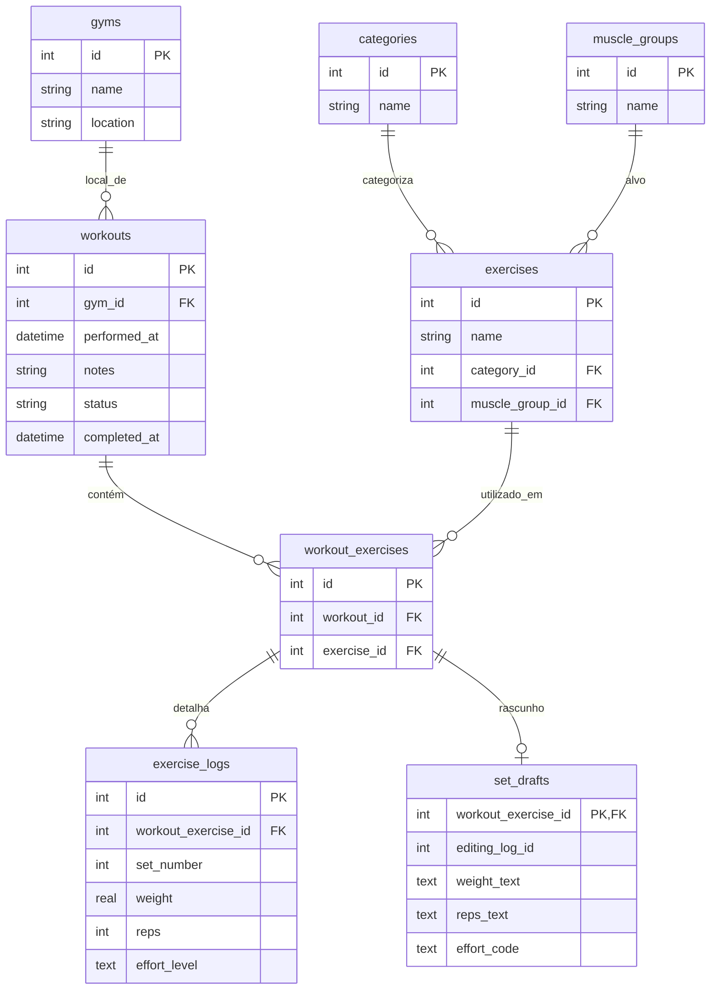

# Project Definition Document (PDR)
## Project Apex: Apex Workout

---

## 1. Executive Summary & Product Vision
**Apex Workout** is a 100% *local-first*, high-performance mobile application engineered for strength athletes, bodybuilders, and fitness enthusiasts. Built specifically for environments with unreliable or non-existent connectivity (such as gym basements), Apex Workout eliminates latency and cloud dependencies by keeping all data, calculations, and routines locally on the device using Flutter and SQLite (via Drift).

The product philosophy rejects rigid, pre-packaged workout routines in favor of fluid, dynamic session building. Athletes can open the app, immediately trigger a workout session, select exercises on the fly, and log granular set-by-set telemetry with unmatched speed and precision.

---

## 2. Technical Architecture & Tech Stack

* **Framework:** Flutter (Cross-platform mobile, iOS & Android)
* **State Management:** Riverpod / Provider for reactive local state handling
* **Local Persistence Engine:** Drift (Type-safe SQLite wrapper for Dart/Flutter)
* **Data Lifecycle:** 
  * Zero remote synchronization required for core workflows.
  * Instant local writes with ACID compliance guaranteed by SQLite.
  * Local asset seeding for default categories and muscle groups on first launch.

---

## 3. Database Schema Specification (Drift / SQLite)

The database architecture is designed with integer primary keys, normalized lookup tables for domains, and strict relational integrity across sessions, exercises, and granular series logs.

### Table Definitions
1. **`gyms`**
   - `id` (INTEGER, PK, Auto-increment)
   - `name` (TEXT) - Name of the gym/facility (e.g., Smart Fit, Home Gym)
   - `location` (TEXT, Nullable) - Address or neighborhood identifier
2. **`categories`**
   - `id` (INTEGER, PK, Auto-increment)
   - `name` (TEXT) - Movement category (e.g., Push, Pull, Legs)
3. **`muscle_groups`**
   - `id` (INTEGER, PK, Auto-increment)
   - `name` (TEXT) - Target muscle (e.g., Chest, Lats, Quadriceps)
4. **`exercises`**
   - `id` (INTEGER, PK, Auto-increment)
   - `name` (TEXT) - Exercise title (e.g., Barbell Bench Press)
   - `category_id` (INTEGER, FK -> `categories.id`)
   - `muscle_group_id` (INTEGER, FK -> `muscle_groups.id`)
5. **`workouts`**
   - `id` (INTEGER, PK, Auto-increment)
   - `gym_id` (INTEGER, FK -> `gyms.id`, Nullable)
   - `performed_at` (DATETIME) - Timestamp when workout session started/occurred
   - `notes` (TEXT, Nullable) - General observations or energy level notes
   - `status` (TEXT) - `legacy`, `active`, or `completed`; at most one active workout.
   - `completed_at` (DATETIME, Nullable) - Actual completion time; unknown for legacy records.
6. **`workout_exercises`**
   - `id` (INTEGER, PK, Auto-increment)
   - `workout_id` (INTEGER, FK -> `workouts.id`)
   - `exercise_id` (INTEGER, FK -> `exercises.id`)
7. **`exercise_logs`**
   - `id` (INTEGER, PK, Auto-increment)
   - `workout_exercise_id` (INTEGER, FK -> `workout_exercises.id`)
   - `set_number` (INTEGER) - Sequential set index
   - `weight` (REAL) - Applied load in kg/lbs
   - `reps` (INTEGER) - Completed repetitions for the set
   - `effort_level` (TEXT, Nullable for legacy records) - Enum: `very_low`, `low`, `medium`, `high`, `failure_at_end`, `failure_before_end`. Required when recording new sets through the repository. UI labels: Muito baixo, Baixo, Médio, Alto, Falha ao final, Falha antes do final.
8. **`set_drafts`**
   - `workout_exercise_id` (INTEGER, PK, FK) - One pending series form per workout exercise.
   - `editing_log_id` (INTEGER, Nullable) - Existing series being edited, otherwise a new series.
   - `weight_text`, `reps_text` (TEXT) - Raw input, including incomplete values.
   - `effort_code` (TEXT, Nullable) - Selected effort code, if any.

---

## 4. UI/UX Design System: *Kinetic Obsidian*

Engineered for intense, high-output athletic contexts where users interact between heavy sets under demanding lighting conditions.

### 4.1. Color Palette
* **Canvas Base (`#101413`):** Deep obsidian with faint green-black undertone.
* **Surface Hierarchy:**
  - `surface-container-low`: `#181c1b` (Grouped section cards)
  - `surface-container`: `#1c201f` (Interactive cards, sheet foundations)
  - `surface-container-high`: `#272b2a` (Inputs, active chips, steppers)
* **Primary Kinetic Energy Accents:**
  - `primary-neon` (`#00E676` / `#75FF9E`): Critical completion actions, PR indicators, progress highlights.
  - `secondary-emerald` (`#4EDEA3`): Secondary states, resting active tags.
* **Semantic & Text Roles:**
  - `text-primary`: `#E0E3E1` (High-contrast numbers and headers)
  - `text-secondary`: `#BACBB9` (Metadata, unit labels)
  - `danger-alert`: `#FFB4AB` (Critical warnings)

### 4.2. Typography
* **Data Metrics & Headings:** `Space Grotesk` (Engineered, technical tabular-like rhythm for fast mid-set reading).
* **Body & Instructional Copy:** `Plus Jakarta Sans` (Geometric legibility with humanist warmth).

### 4.3. Shape System
* **Micro-elements / Badges:** `rounded-md` (0.5rem / 8px)
* **Inputs & Steppers:** `rounded-lg` (1rem / 16px)
* **Workout Cards & Sheets:** `rounded-xl` (1.5rem / 24px)

---

## 5. Functional Requirements & Screen Specifications

1. **Main Screen:**
   - Dynamic time-based greeting ("Bom dia", "Boa tarde", "Boa noite").
   - Central prominent CTA button ("Iniciar Exercício") styled with neon accent and glow shadow (`56px` height).
   - Action instantly inserts a record into `workouts` and redirects to session assembly.
2. **Active Workout Flow:**
   - Dynamic exercise picker populated from `exercises`.
   - Real-time row addition for sets, capturing explicit weight and repetition metrics into `exercise_logs`.
   - Optional gym and notes; each selected exercise displays its category and muscle group.
   - Multiple exercises and sets; edit/delete sets and remove exercises with confirmation.
   - Required effort selection, nonnegative finite load in kg, and positive integer repetitions.
   - Persist incomplete series forms locally on change and show save/error feedback.
   - Resume the single active workout through "Continuar treino" after reopening.
   - Confirm "Encerrar treino" only after pending drafts are completed or explicitly discarded.
   - Completed workouts are read-only; legacy workouts can be explicitly resumed when no active workout exists.
3. **Base Entity CRUD Module:**
   - Management interfaces for `gyms`, `categories`, `muscle_groups`, and `exercises`.
4. **Workout History Screen:**
   - Chronological list of historical sessions (`workouts`).
   - Read-only breakdown view displaying exercises performed and granular set-by-set telemetry.
   - Allow deleting a workout after explicit confirmation, including its linked
     session exercises, set logs, and pending drafts in a single transaction.

---

## 6. Task Breakdown & Execution Plan

### **Phase 1: Foundation & Data Layer (Drift / SQLite)**
* **Task 1.1:** Initialize Flutter project structure and configure dependencies (`drift`, `sqlite3_flutter_libs`, `path_provider`, state management).
* **Task 1.2:** Implement Drift database schema classes (`Gyms`, `Categories`, `MuscleGroups`, `Exercises`, `Workouts`, `WorkoutExercises`, `ExerciseLogs`).
* **Task 1.3:** Configure local database connection and migration handler; populate initial seed data for default categories and muscle groups.

### **Phase 2: Base Entity CRUD Module**
* **Task 2.1:** Build listing and form screens for Gym management (`gyms`).
* **Task 2.2:** Build management screens for Movement Categories and Muscle Groups.
* **Task 2.3:** Build full CRUD module for Exercises with foreign key selectors for categories and muscle groups.

### **Phase 3: Main Screen & Session Initiation**
* **Task 3.1:** Construct the Main Screen UI adhering to the *Kinetic Obsidian* theme, incorporating dynamic time-based greetings and the central primary CTA button.
* **Task 3.2:** Implement database insertion logic to trigger a new session record in `workouts` upon tapping "Iniciar Exercício".

### **Phase 4: Active Workout & Granular Logging Flow**
* **Task 4.1:** Build the active session interface to browse and append exercises dynamically into `workout_exercises`.
* **Task 4.2:** Develop the set logging interface supporting real-time addition of sets (`set_number`, `weight`, `reps`, `effort_level`) linked to `exercise_logs`, with mandatory effort selection using the six enum labels.

### **Phase 5: Workout History & Review Module**
* **Task 5.1:** Develop the History Screen listing completed training sessions in reverse chronological order.
* **Task 5.2:** Implement the read-only session inspection view displaying full exercise breakdowns and telemetry logs.
