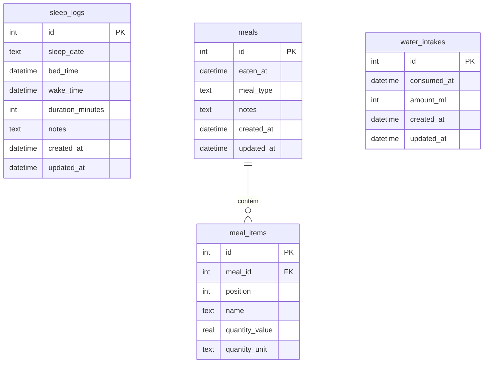

# Project Definition Document (PDR)
## Apex Workout — Módulo Bem-estar

Estado: **Aguardando aprovação do usuário**.
Base: versão 1.0 validada, banco Drift `schemaVersion` 4.

---

## 1. Visão e objetivo

O módulo **Bem-estar** registra a rotina diária fora da academia para formar um
histórico local e consultável.

Escopo inicial, nesta ordem de importância:

1. **Sono** — quantidade diária de sono, com horários opcionais.
2. **Alimentação** — histórico de horários das refeições, quantidade de
   refeições por dia, observações e itens com quantidade opcional.
3. **Água** — quantidade ingerida ao longo do dia.

Princípios:

- **Não é contador de calorias.** O dado central da refeição é o horário;
  descrição, itens e quantidades são opcionais.
- **Registro rápido.** Água em um toque; refeição válida apenas com horário.
- **Registro retroativo.** É possível lançar e corrigir dias anteriores.
- **Local-first.** Mesma arquitetura: Riverpod, Drift/SQLite, sem rede.

### Fora do escopo

- Calorias, macronutrientes, base de alimentos ou código de barras.
- Metas diárias, lembretes e notificações.
- Qualidade do sono, estresse, peso corporal e dores musculares.
- Integração com Health Connect, HealthKit ou relógios.
- Exportação de dados e integração com RAG (adiadas).
- Sincronização em nuvem.

Esses itens podem virar módulos futuros; o esquema não os antecipa.

---

## 2. Regras de domínio

### 2.1. Dia de referência

- Refeições e água pertencem ao **dia civil local** do seu horário.
  Uma refeição às 00:30 pertence ao dia seguinte.
- Sono pertence ao **dia em que se acorda** (`sleep_date`). A noite de
  02 → 03/10 conta como sono de 03/10.
- Horários são persistidos como `DateTime` do Drift e exibidos no fuso local.
  Consultas por dia usam o intervalo `[00:00 do dia, 00:00 do dia seguinte)`.
- Horários futuros são rejeitados (referência: `clockProvider`).

### 2.2. Sono

- Cada registro é um **período de sono**; o dia pode ter vários
  (noite e cochilos). O **sono diário** é a soma dos períodos do dia.
- Duas formas de lançamento:
  - **Horários:** dormiu às / acordou às. A duração é calculada; `sleep_date`
    é a data do horário de acordar.
  - **Duração:** data + horas e minutos, quando os horários são desconhecidos.
- Invariantes:
  - `duration_minutes` entre 1 e 1440.
  - `bed_time` e `wake_time` são ambos informados ou ambos nulos.
  - Com horários: `wake_time > bed_time`, intervalo ≤ 24 h e
    `duration_minutes` igual ao intervalo (calculado pelo repositório).
  - Períodos com horários não podem se sobrepor.
  - A soma de um dia não pode ultrapassar 1440 minutos.

### 2.3. Refeições

- Uma refeição é válida apenas com `eaten_at`.
- **Quantidade de refeições do dia** = número de registros do dia.
- Tipo opcional, com códigos estáveis:

| Código | Rótulo |
| --- | --- |
| `breakfast` | Café da manhã |
| `lunch` | Almoço |
| `snack` | Lanche |
| `dinner` | Jantar |
| `supper` | Ceia |
| `pre_workout` | Pré-treino |
| `post_workout` | Pós-treino |
| `other` | Outra |

- Observações opcionais (ex.: “comi com pressa”, “senti estufamento”).
- Itens opcionais, em ordem: nome obrigatório e quantidade opcional.
  Quantidade e unidade são ambas informadas ou ambas nulas.
  Quantidade é finita e maior que zero; a interface aceita vírgula.

| Unidade | Rótulo |
| --- | --- |
| `g` | Gramas |
| `ml` | Mililitros |
| `unit` | Unidades |

### 2.4. Água

- Cada ingestão é um registro com horário e volume em ml.
- Volume inteiro entre 1 e 5000 ml por registro.
- **Água diária** = soma dos registros do dia.
- Atalhos de 250 ml e 500 ml; valor personalizado pelo formulário.

### 2.5. Textos e edição

- Textos são normalizados com `trim`; vazio é armazenado como `NULL`.
- Todos os registros podem ser editados e excluídos; exclusão pede confirmação.
- Excluir refeição remove seus itens na mesma transação (sem cascata no
  banco, seguindo a convenção atual).
- `created_at` e `updated_at` são mantidos pelo repositório. Preservam a
  distinção entre registro feito na hora e lançamento retroativo, que não
  poderia ser reconstruída depois.

---

## 3. Esquema de dados — versão 5



### 3.1. Definições

1. **`sleep_logs`**
   - `id` INTEGER PK autoincremento.
   - `sleep_date` TEXT `YYYY-MM-DD`, `CHECK` de formato.
   - `bed_time`, `wake_time` DATETIME nulos; `CHECK` ambos ou nenhum e
     `wake_time > bed_time`.
   - `duration_minutes` INTEGER, `CHECK` entre 1 e 1440.
   - `notes` TEXT nulo.
   - `created_at`, `updated_at` DATETIME.
   - Índice em `sleep_date`.
2. **`meals`**
   - `id` INTEGER PK autoincremento.
   - `eaten_at` DATETIME.
   - `meal_type` TEXT nulo, `CHECK` com os códigos da seção 2.3.
   - `notes` TEXT nulo.
   - `created_at`, `updated_at` DATETIME.
   - Índice em `eaten_at`.
3. **`meal_items`**
   - `id` INTEGER PK autoincremento.
   - `meal_id` INTEGER FK → `meals.id`.
   - `position` INTEGER ≥ 1; único por `(meal_id, position)`.
   - `name` TEXT não vazio.
   - `quantity_value` REAL nulo, `CHECK > 0`.
   - `quantity_unit` TEXT nulo, `CHECK` em `g`, `ml`, `unit`;
     `CHECK` ambos ou nenhum.
4. **`water_intakes`**
   - `id` INTEGER PK autoincremento.
   - `consumed_at` DATETIME.
   - `amount_ml` INTEGER, `CHECK` entre 1 e 5000.
   - `created_at`, `updated_at` DATETIME.
   - Índice em `consumed_at`.

Regras que dependem de outros registros (sobreposição de sono, soma diária,
horário futuro, duração igual ao intervalo) ficam no repositório.

### 3.2. Migração

- `schemaVersion` passa de 4 para 5.
- `onUpgrade` deixa de exigir `to == 4` e aplica passos cumulativos:
  `from < 4` executa os passos existentes; `from < 5` cria as quatro tabelas
  e índices. Versões desconhecidas continuam falhando com mensagem clara.
- Nenhum dado de treino é alterado.
- `docs/database.md` e o PDR principal passam a descrever a versão 5.

---

## 4. Arquitetura

```
lib/core/database/tables/
  sleep_logs.dart  meals.dart  meal_items.dart  water_intakes.dart
lib/features/wellness/
  domain/   meal_type.dart  quantity_unit.dart  wellness_day.dart
  data/     wellness_repository.dart
  providers/wellness_providers.dart
  presentation/
            wellness_screen.dart  wellness_history_screen.dart
            sleep_form_screen.dart  meal_form_screen.dart
            water_form_sheet.dart
```

- `MealType` e `QuantityUnit` seguem o padrão de `MeasurementUnit`:
  `storageValue`, `label` e `fromStorage` com erro para código desconhecido.
- `WellnessRepository` usa a fila `_write` com transação, como
  `WorkoutRepository`, e recebe `CurrentTime` para validar horários futuros.
- `WellnessDay`: data, períodos de sono, refeições com itens, ingestões de
  água e totais (`sleepMinutes`, `mealCount`, `waterMl`).
- Providers: repositório, `wellnessDayProvider(DateTime)` como stream e
  `wellnessHistoryProvider` com resumos por dia.
- Formatação de data/hora sem nova dependência (24 h, `dd/MM/yyyy`).

---

## 5. Interface

Tema *Kinetic Obsidian* existente; textos em português.

### 5.1. Navegação

- `ApexNavigationDrawer` ganha o destino **Bem-estar** abaixo de **Treinos**,
  com índice selecionado conforme a tela atual.

### 5.2. Tela Bem-estar (dia)

- Cabeçalho com dia anterior, data (abre seletor) e próximo dia; o próximo
  dia fica desabilitado em hoje.
- Três cartões com total e lista do dia:
  - **Sono:** total `7 h 30 min`; períodos com horários ou “duração informada”.
  - **Refeições:** quantidade; lista cronológica com horário, tipo,
    resumo dos itens e observações.
  - **Água:** total em ml/L; botões +250 ml, +500 ml e personalizado;
    lista com horário e volume.
- Toque no item edita; lixeira exclui com confirmação.
- Novos registros usam o dia selecionado; o horário padrão é agora em hoje e
  12:00 em dias anteriores, sempre editável.
- Estados de carregamento, vazio e erro com nova tentativa; sucesso e falha
  ao salvar informados por `SnackBar`.

### 5.3. Formulários

- **Sono:** alternância “Horários” / “Duração”; seletores nativos de data e
  hora; duração calculada exibida antes de salvar; observações.
- **Refeição:** data e hora, tipo opcional, observações, itens adicionáveis,
  removíveis e reordenáveis por posição, com quantidade e unidade opcionais.
- **Água:** horário e volume em ml.
- Validação nos campos, com as regras da seção 2; layout sem overflow em
  320 × 640 com teclado aberto.

### 5.4. Histórico de bem-estar

- Lista reversa dos dias com algum registro: data, sono, refeições, água.
- Toque abre a tela do dia correspondente.

---

## 6. Plano de tarefas

Cada tarefa segue o fluxo do `AGENTS.md`: plano, aprovação, implementação,
teste do usuário.

### Fase 6 — Dados

- **Tarefa 6.1:** Tabelas, enums `MealType` e `QuantityUnit`, versão 5,
  migração cumulativa, geração Drift e documentação do banco.
  - Conclusão: banco novo e bancos v1–v4 abrem em v5 preservando treinos;
    restrições `CHECK` e FK rejeitam dados inválidos; reabertura persiste.
- **Tarefa 6.2:** `WellnessRepository`, `WellnessDay` e providers.
  - Conclusão: CRUD dos três registros; todas as regras da seção 2; consultas
    por dia nos limites de meia-noite; soma do dia; exclusão transacional da
    refeição com itens; streams reativos.

### Fase 7 — Interface

- **Tarefa 7.1:** Destino no drawer e tela do dia com navegação entre datas,
  cartões, totais e estados.
- **Tarefa 7.2:** Registro, edição e exclusão de sono.
- **Tarefa 7.3:** Registro, edição e exclusão de refeições e itens.
- **Tarefa 7.4:** Água: atalhos, valor personalizado, edição e exclusão.
- **Tarefa 7.5:** Histórico de bem-estar e abertura do dia.
  - Conclusão comum: fluxo validado em teste de interface, persistência após
    reiniciar, layout de 320 × 640 sem overflow.

### Verificações por tarefa

- `dart run build_runner build --delete-conflicting-outputs` quando houver
  alteração de tabela.
- `dart format lib test`, `flutter analyze`, `flutter test`.
- `flutter build web` nas tarefas de interface; teste manual pelo usuário.

---

## 7. Decisões a confirmar na aprovação

1. Sono por **períodos** (noite + cochilos) em vez de um valor único por dia.
2. Acesso pelo **drawer** em vez de barra inferior de navegação.
